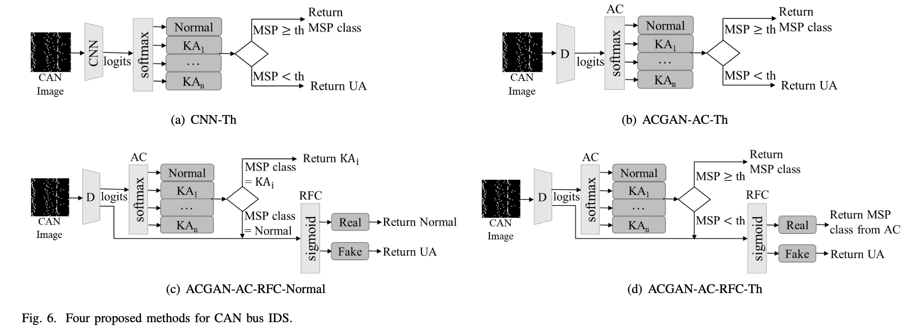
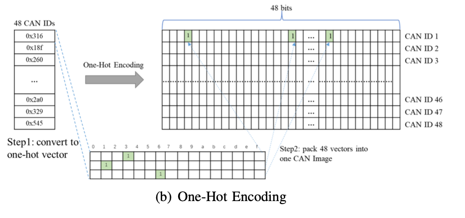
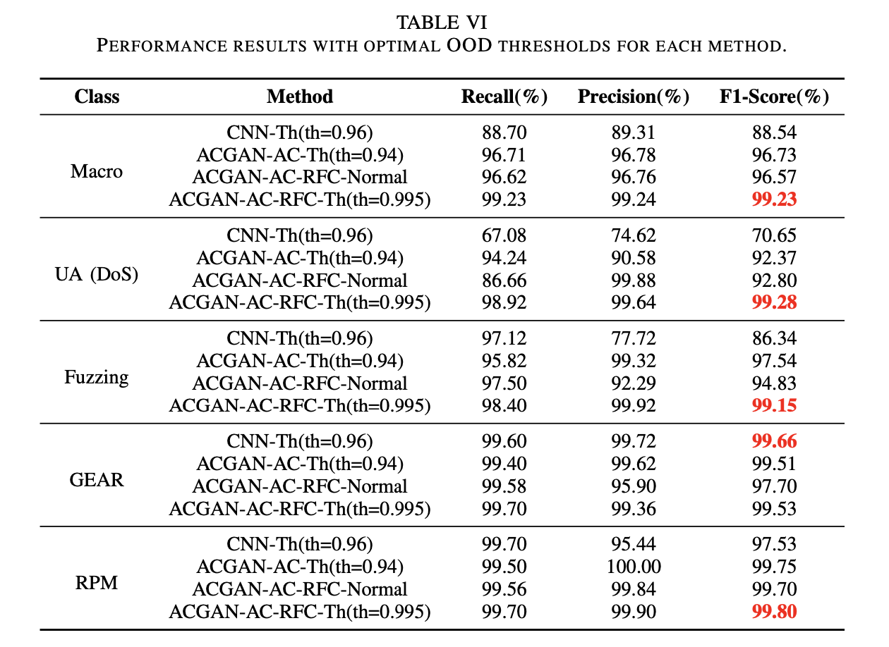

# CAN_GAN_Anomaly
"CAN bus intrusion detection based on auxiliary classifier GAN and out-of-distribution detection" Code 

## Notice
This project is migrated from [`github.com/leyiweb/CAN_GAN_Anomaly`](https://github.com/leyiweb/CAN_GAN_Anomaly). Due to an erroneous blockage from Microsoft, we decided to move the repository. 

Now, you can find the project at [`github.com/evenchen6/CAN_GAN_Anomaly`](https://github.com/evenchen6/CAN_GAN_Anomaly).

We appreciate your support and we will continue to maintain and update this project. 

If you have any questions or suggestions, feel free to raise an issue. 


## Abstract
Modern vehicles are prototypical Cyber-Physical Systems, where the
in-vehicle Electrical/Electronic (E/E) system interacts closely with its
physical surroundings. With the rapid advances in Connected and Automated
Vehicles, the issue of automotive cyber-physical security is gaining
increasing importance. The Controller Area Network (CAN) is a ubiquitous
bus protocol present in almost all vehicles. Due to its broadcast nature,
it is vulnerable to a range of attacks once the attacker gains access to
the bus through either the physical or cyber part of the attack surface. We
address the problem of Intrusion Detection on the CAN bus, and propose four
methods based on the combination of one or more classifiers trained with
Auxiliary Classifier Generative Adversarial Network (ACGAN), and the use of
Out-of-Distribution (OOD) Detection to detect unknown attacks. Our work is
the first and only technique that is able to detect both known and unknown
attacks, and also assign fine-grained labels to detected known attacks. Experimental
results demonstrate that the most effective method is a cascaded two-stage
classification architecture, with the multi-class Auxiliary Classifier in
the first stage, passing OOD samples to the binary Real/Fake Classifier in
the second state.

## Model structure


## Dataset
You can download the raw data from [CAN Datasets](https://ocslab.hksecurity.net/Datasets/CAN-intrusion-dataset)

Convert raw data to CAN Image can refer to the method in figure 

## Result


## Conda environment
```shell
    # create conda environment
    conda create -n ACGIDS python=3.7 -c conda-forge
    # If you are using a Mac with an M-series (Apple Silicon) chip and need Intel (x86_64) compatibility, you can specify the platform as follows:
    CONDA_SUBDIR=osx-64 conda create -n ACGIDS python=3.7 -c conda-forge
    # Or with newer Conda versions (>=23.10.0), you can use:
    conda create --platform osx-64 -n ACGIDS python=3.7 -c conda-forge

    # delete conda environment
    conda remove -n ACGIDS --all

    # activate conda environment
    conda activate ACGIDS
    
    # install third-party libraries
    # It is safe to ignore the warning about Pillow version incompatibility (visualdl 2.2.0 requires Pillow>=7.0.0, but you have pillow 6.2.2) as long as VisualDL runs smoothly. If any errors occur, consider upgrading Pillow to a supported version.
    pip install --user --requirement requirements.txt
```

## Usage
```shell
    # Train Script
    bash experiments/run_can.sh
    
    # Test Script
    # NOTE: Need to be modified to your storage model parameter location
    # NOTE: The pkl folder provides the same model parameters as the experiments in the paper, if needed, you can use
    bash experiments/run_can_val.sh
```

## Visualdl
```shell
    # you can pip visualdl lib follow as:
    pip install visualdl -i https://mirrors.aliyun.com/pypi/simple
    
    # start visualdl service, load model saved log
    nohup visualdl --logdir log --port 8080 &
```

if you find our model/method/dataset useful, please cite our work:
```angular2html
@article{chen2022can,
  title={CAN bus intrusion detection based on auxiliary classifier GAN and out-of-distribution detection},
  author={Zhao, Qingling and Chen, Mingqiang and Gu, Zonghua and Luan, Siyu and Zeng, Haibo and Chakrabory, Samarjit},
  journal={ACM Transactions on Embedded Computing Systems (TECS)},
  volume={21},
  number={4},
  pages={1--30},
  year={2022},
  publisher={ACM New York, NY}
}
```